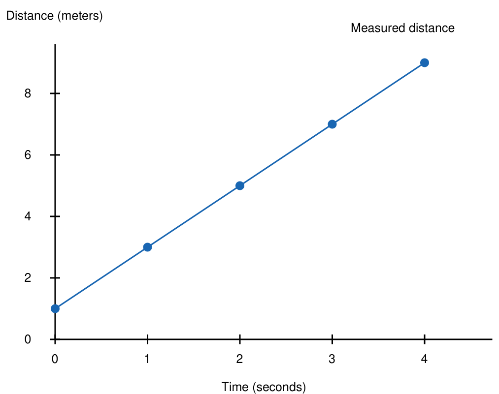

# AI 视觉翻译测试

模型必须识别图表、翻译其标签并重建表格。

该关系为线性关系：$y = 2x + 1$。

纵轴标题：距离（米）；横轴标题：时间（秒）；图例：测量距离；纵轴刻度：0、2、4、6、8；横轴刻度：0、1、2、3、4。

图 1. 匀速运动。

**表 1. 实验观测数据**

| 时间（秒） | 距离（米） | 状态 |
|---|---|---|
| 0 | 1 | 初始 |
| 2 | 5 | 稳定 |

结论：距离随时间稳步增加。
